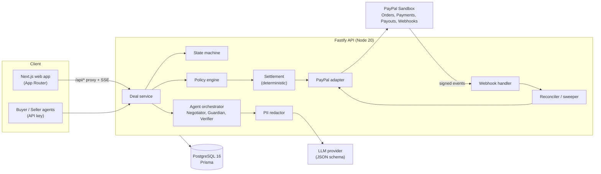
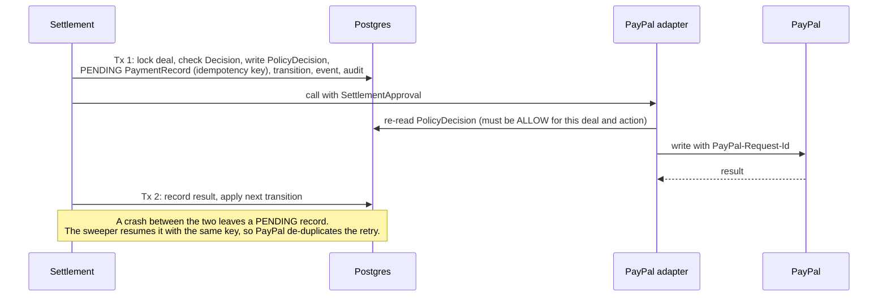
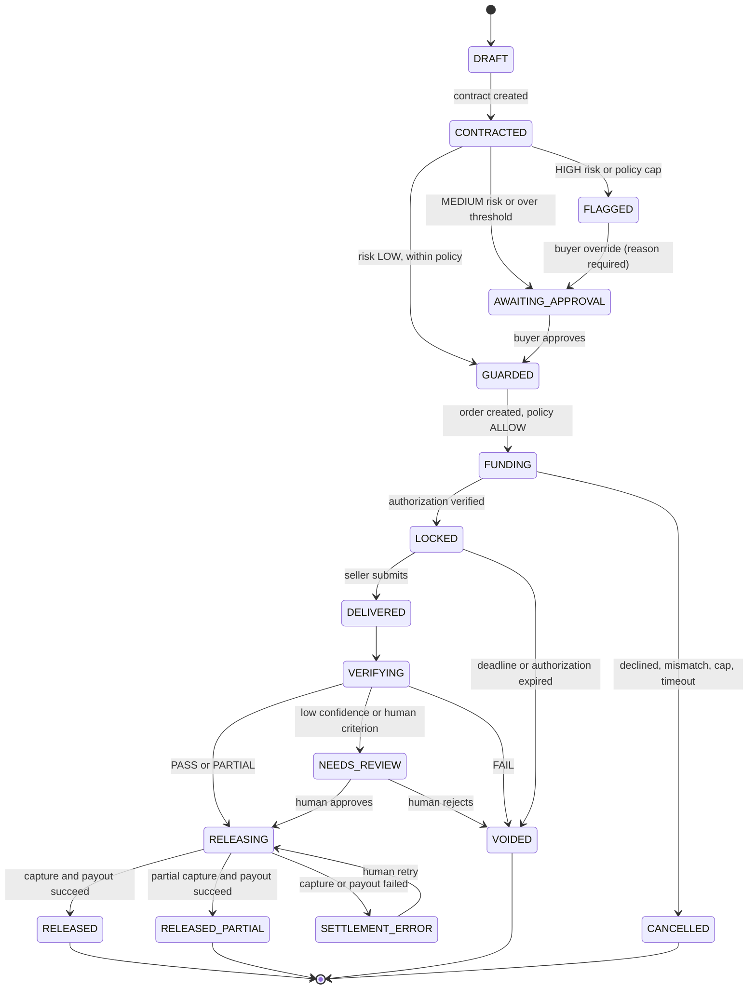

<div align="center">

# Paylock

**AI escrow that pays on proof.**

An escrow agent built on the PayPal developer platform. It screens the counterparty, reserves the buyer's funds, verifies delivered work against agreed acceptance criteria, and releases payment only when the work passes.

`Node 20` · `TypeScript` · `Next.js 15` · `Fastify 5` · `PostgreSQL 16` · `PayPal Sandbox` · `MIT`

Built for the PayPal AI Hackathon 2026.

</div>

---

## Table of contents

1. [The problem](#1-the-problem)
2. [The solution](#2-the-solution)
3. [How a deal works](#3-how-a-deal-works)
4. [The AI agents](#4-the-ai-agents)
5. [Architecture](#5-architecture)
6. [Deal state machine](#6-deal-state-machine)
7. [Safety model](#7-safety-model)
8. [PayPal integration](#8-paypal-integration)
9. [Tech stack](#9-tech-stack)
10. [Repository layout](#10-repository-layout)
11. [Getting started](#11-getting-started)
12. [Configuration](#12-configuration)
13. [Scripts](#13-scripts)
14. [Testing and quality](#14-testing-and-quality)
15. [Demo walkthrough](#15-demo-walkthrough)
16. [API reference](#16-api-reference)
17. [Deployment](#17-deployment)
18. [Built with the PayPal AI Toolkit](#18-built-with-the-paypal-ai-toolkit)
19. [Known limitations](#19-known-limitations)
20. [Documentation index](#20-documentation-index)
21. [Contributing](#21-contributing)
22. [License](#22-license)

---

## 1. The problem

When someone pays for work online, one side has to trust the other first.

- If the **buyer pays first**, they hope the seller delivers. Fake freelancers take deposits and disappear.
- If the **seller works first**, they hope the buyer pays. Freelancers finish the job and get ghosted.

Payments and trust live in different systems, so money moves before anyone knows whether the deal is real. Traditional escrow is built for large purchases, and its fees and timelines make no sense for a $200 logo. Marketplaces hold funds, but only inside their own walls, and approval is a manual button. Meanwhile, AI agents are starting to spend money on behalf of people, and an agent with a wallet and no judgment is a scammer's best target.

## 2. The solution

Paylock puts an AI agent between the agreement and the payment. Three agents handle language and judgment. Plain, tested code handles the money.

| Capability | What it does |
|---|---|
| **Negotiate** | Turns a plain-language request into a structured contract with weighted, testable acceptance criteria. |
| **Guard** | Scores counterparty and message risk before any money is reserved, and explains every signal that fired. |
| **Lock** | Reserves the buyer's funds with PayPal authorize-then-capture. The seller can see the money is held. |
| **Verify** | Checks the delivered work against each criterion and cites evidence. |
| **Release** | On pass, deterministic code captures the authorization and pays the seller through PayPal Payouts. On fail, it voids the authorization and the buyer keeps their money. A partial pass captures a proportional amount. |
| **Audit** | Every agent decision, warning, override and payment lands on an append-only timeline. |

**Agents recommend. The platform enforces policy and moves money.** No agent can call a PayPal write.

## 3. How a deal works

1. **Describe the job.** The buyer types what they need. The Negotiator returns a contract (scope, price, deadline, criteria).
2. **Screen the seller.** The Trust Guardian combines rule-based signals with an LLM read of the messages and returns a risk level (LOW, MEDIUM, HIGH) with reasons.
3. **Policy check.** The server applies the buyer's spend policy (per-deal limit, daily cap, approval threshold). LOW risk within limits proceeds. MEDIUM or over-threshold needs the buyer's approval. HIGH is blocked unless the buyer overrides with a reason.
4. **Reserve funds.** The buyer approves in the PayPal v6 popup. Paylock verifies the order (amount, currency, `custom_id`) before the deal is marked `LOCKED`.
5. **Deliver.** The seller submits a URL, text, file or repo.
6. **Verify.** The Verifier scores the work against the criteria.
7. **Settle.**
   - **PASS:** capture the full amount, then pay the seller. State `RELEASED`.
   - **PARTIAL** (score at or above `partialPayMin`, default 70): capture a proportional amount with `final_capture: true`, then pay the seller. State `RELEASED_PARTIAL`.
   - **FAIL:** void the authorization. State `VOIDED`, "funds returned".
   - **Uncertain** (low confidence, a human-only criterion, or an overridden deal): `NEEDS_REVIEW`, and a human decides.

Missed deadlines and expired authorizations void automatically, so the buyer is never left with money stuck in limbo.

## 4. The AI agents

| Agent | Trigger | Output | Notes |
|---|---|---|---|
| **Negotiator** | Deal created | `ContractOut` | 1 to 10 criteria, each marked `automatic`, `llm` or `human`. Never invents a deadline. |
| **Trust Guardian** | Before funding | `RiskOut` | Deterministic rules weighted above LLM signals. Falls back to rules-only if the LLM fails validation twice. |
| **Verifier** | Deliverable submitted | `DecisionOut` | Per-criterion evidence and confidence. Low confidence routes to a human. |
| **Settlement** | Decision stored | `PaymentRecord`s | **Not an LLM.** Deterministic code behind the policy engine and the PayPal adapter. |

Design rules, enforced in code and tests:

- **Structured outputs only.** Every agent response is validated against a Zod schema in `packages/schemas`. Free text is never parsed.
- **Untrusted text is fenced.** Deliverables, messages and tool results are wrapped in `<DELIVERABLE>`, `<MESSAGE>` and `<TOOL_RESULT>` blocks, with an instruction to ignore embedded directives.
- **Fail safe.** Invalid or low-confidence output never releases funds. It routes to `NEEDS_REVIEW` or blocks.
- **PII redaction.** Emails, names, phones and PayPal ids are replaced with stable tokens before any LLM call and restored on output.
- **Tools are read-only.** The orchestrator calls read-only skills and passes the results into the prompt. Agents never receive a write skill.

### Risk scoring (Trust Guardian)

Rule signals are summed and clamped to 0 to 100. LLM signals add 0 to 25 each, scaled by confidence.

| Signal | Condition | Weight |
|---|---|---|
| `NEW_ACCOUNT` | Account younger than 7 days | +25 |
| `PAYOUT_EMAIL_CHANGED_RECENTLY` | Changed less than 24 hours before the deal | +25 |
| `PAYOUT_EMAIL_MISMATCH` | Payout email domain differs from contact | +15 |
| `ZERO_HISTORY` | No completed deals | +10 |
| `HIGH_FAILURE_RATE` | Failure rate above 30% with at least 3 deals | +20 |
| `DISPUTES` / `REPORTS` | Per dispute / per report received | +15 / +10 each, capped at 30 |
| `VELOCITY` | More than 5 deals in 10 minutes | +20 |
| `UNDER_THRESHOLD_SPLITTING` | Repeated amounts just under the approval threshold | +20 |
| `PAYPAL_UNVERIFIED` | Seller or buyer PayPal account unverified | +10 |
| `ESTABLISHED` | Over 90 days, 10+ deals, no disputes | -20 |
| LLM: `OFF_PLATFORM_REQUEST`, `UPFRONT_FEE_REQUEST`, `FRIENDS_FAMILY_REQUEST`, `URGENCY_PRESSURE`, `OVERPAYMENT_SCHEME`, `IDENTITY_MISMATCH`, `TOO_GOOD_PRICING` | Social-engineering patterns in message text | +0 to +25 |

Levels: **0 to 29 LOW**, **30 to 59 MEDIUM**, **60 to 100 HIGH**. Signals are behavior-based only, never demographic, and the copy describes signals rather than labeling people.

## 5. Architecture

Paylock is a **modular monolith**: one API service, one web app, one Postgres database. Agents are in-process modules with clear boundaries.



**Key decisions** (full ADRs in [`docs/ARCHITECTURE.md`](docs/ARCHITECTURE.md)):

| ADR | Decision |
|---|---|
| 001 | **Authorize-then-capture**, not true escrow. PayPal has no native escrow, so the UI says "funds reserved". Contract deadlines are capped at 72 hours after authorization to stay inside PayPal's guaranteed 3-day honor period. |
| 003 | **Server-side policy enforcement.** The UI only reflects decisions. |
| 004 | **Schema-validated agent outputs** with one retry, then a safe fallback. |
| 007 | **PII never reaches the LLM in clear text.** Redaction is middleware, not opt-in. |
| 008 | **MCP for read-only enrichment; REST adapter for money.** MCP write tools are never called. |
| 009 | **Synchronous confirmation, webhook reconciliation.** Sandbox webhooks can take 10 to 75+ seconds, so state moves on the synchronous PayPal response and webhooks confirm. |
| 011 | **Two-transaction settlement.** A PayPal call cannot run inside a DB transaction, so each money step is split in two with a crash-safe pending record in between. |

### Two-transaction settlement



## 6. Deal state machine

The state machine in `apps/api/src/deals/state-machine.ts` is a pure function: `(state, event, context) -> next state | error`. Transitions are persisted with a `DealEvent` and an `AuditLog` row under `SELECT ... FOR UPDATE` on the deal row.



The diagram omits some edges (cancel paths, void retries, refund). The complete table is in [`docs/DESIGN.md`](docs/DESIGN.md) section 3, and a test keeps the code and that table in sync.

## 7. Safety model

These invariants are enforced in code and covered by tests.

| Invariant | How it holds |
|---|---|
| **No money moves without proof of policy.** | Capture, payout and refund require a persisted `Decision` and a `PolicyDecision` written in the same transaction as the pending payment record. The adapter re-checks it before calling PayPal. |
| **All PayPal writes are idempotent.** | `PayPal-Request-Id = sha256(dealId:action:attempt)`, bound to one exact request body. Retries reuse the key. A different amount is a new attempt. |
| **Money is never a float.** | Decimal strings (`^\d{1,10}\.\d{2}$`) in APIs and agent outputs, `Decimal(12,2)` in the database. USD only. Amounts round down so Paylock never captures more than authorized. |
| **Agents cannot move money.** | They emit schema-validated decisions. Settlement is deterministic code with no LLM. |
| **Prompt injection is contained.** | Untrusted text is fenced, outputs are schema-only, and agents have no write tools. |
| **Webhooks cannot regress state.** | Signature verified from the raw body, de-duplicated by event id, and used only to append events and wake the reconciler. |
| **`/authorize` never trusts the client.** | It ignores any client-supplied order id, reads the stored order from PayPal, and checks status, amount, currency and `custom_id`. |
| **SSRF-resistant URL fetching.** | `fetch_url` blocks private ranges, checks DNS rebinding, and caps redirects. |
| **Kill switch.** | `PAYLOCK_FREEZE=1` blocks every money write. Void stays allowed because it returns funds to the buyer. |
| **No secrets or PII in logs.** | Pino with redaction config. Secret scanning (gitleaks) runs in CI. |
| **Test-only funding route is locked down.** | `POST /test/fund-with-card` exists only when `PAYPAL_ENV=sandbox`, `E2E_FUNDING=card` and `NODE_ENV != production`. A test asserts a 404 under production config. |

Agent keys (`X-Agent-Key`) are scoped (`deals:write`, `deliverables:write`) and stored as SHA-256 hashes. Approve, override, fund, authorize, retry, refund and policy changes require a human session. Cookie-authenticated writes from a foreign `Origin` receive 403. Full threat model: [`docs/SECURITY_PRIVACY.md`](docs/SECURITY_PRIVACY.md).

## 8. PayPal integration

| Area | Usage |
|---|---|
| **Orders v2** | `intent=AUTHORIZE`, `custom_id = dealId`. |
| **Payments v2** | Authorize, capture (`final_capture: true`, always sent explicitly), void, refund. |
| **Payouts v1** | Seller payout with `sender_batch_id = paylock-{dealId}-{attempt}` and `sender_item_id = dealId`. |
| **Webhooks v1** | Signature verification on the raw body, event de-duplication, reconciliation. |
| **Reporting** | Platform balance pre-check before payouts. |
| **JS SDK v6** | Buyer approval via `createInstance`, `findEligibleMethods()` and a `<paypal-button>` web component. The browser receives only the public `clientId`, at runtime from `GET /config/paypal`. |
| **PayPal MCP server** | Optional and read-only. Currently disabled: in sandbox testing every tool call returned `PAYPAL_API_SETUP_ERROR`. Re-checked with `npm run mcp:list-tools`. |

All writes go through one module, `apps/api/src/paypal/adapter.ts`. The app obtains its own tokens with the client-credentials grant (`apps/api/src/paypal/token.ts`) and caches them until 60 seconds before expiry.

Every PayPal error hit during the build, and its fix, is logged in [`docs/pitfalls.md`](docs/pitfalls.md).

## 9. Tech stack

| Layer | Technology |
|---|---|
| Frontend | Next.js 15 (App Router), React 19, Tailwind CSS v4, `lucide-react` |
| API | Node.js 20.19+, Fastify 5, Pino |
| Database | PostgreSQL 16, Prisma 6 |
| Validation and money | Zod 4, `decimal.js` |
| Payments | PayPal Orders v2, Payments v2, Payouts v1, Webhooks v1, JS SDK v6 (sandbox) |
| LLM | OpenAI-compatible or Anthropic client, JSON-schema output, configurable per environment |
| Build and test | npm workspaces, `tsup`, `tsx`, Vitest 4, Playwright, axe-core |
| CI | GitHub Actions: lint, typecheck, tests with a Postgres service, build, gitleaks |
| Hosting | Render (Blueprint in `render.yaml`) |

## 10. Repository layout

```
apps/
  api/                 Fastify API
    prisma/            Schema and migrations
    src/
      agents/          Negotiator, Guardian (rules), Verifier, prompt fencing, stub agents
      auth/            Demo sessions, API keys
      deals/           State machine, executor, funding, payments, routes, SSE bus
      llm/             Provider clients, structured output, redaction, replay
      paypal/          Adapter, token, HTTP core, idempotency, error mapping
      policy/          Policy engine and PolicyDecision persistence
      settlement/      Payment math, settlement driver, sweeper
      webhooks/        Signature verification, store, processor, route
      eval/            Agent evaluation runner
      demo/            Seeded personas
  web/                 Next.js app
    app/               Landing, deals, new deal, deal detail, spend policy, demo deliverables
    components/        Primitives (Button, Card, Dialog...) and deal components
    e2e/               Playwright specs
packages/
  schemas/             Zod schemas shared by API and web (deal, agents, money)
  skills/              Read-only agent tools (fetch_url, HTML parsing, SSRF guard)
fixtures/
  deliverables/        Sample pass, bad and portfolio pages
  eval/                Agent evaluation cases
  replay/              Recorded LLM responses used by replay mode
scripts/               PayPal smoke tests, webhook registration, void-all, LLM probe, MCP lister
docs/                  PRD, architecture, design, workflow, security, runbooks
```

## 11. Getting started

### Prerequisites

- Node.js **20.19+** and npm 10+ (`nvm use` reads `.nvmrc`)
- Docker, for local PostgreSQL 16
- `jq`, for `scripts/curl-happy.sh`
- A PayPal Developer account with:
  - a **US** sandbox business account and a sandbox REST app assigned to it, with **Payouts** and **Transaction Search** enabled under Features
  - two US sandbox personal accounts (buyer and seller)
  - payment review turned **off** on the business account, otherwise authorizations can stay `PENDING`
- An LLM API key, only if you run agents in `live` mode
- A public HTTPS tunnel such as ngrok, only if you want real webhooks locally

### Install and run

```bash
git clone https://github.com/MohdAltamish/PayLock.git paylock
cd paylock
nvm use
npm install                    # also runs prisma generate

cp .env.example .env
chmod 600 .env                 # then fill in the values (see Configuration)

docker compose up -d postgres
npm run db:migrate
npm run seed                   # demo users and four seller personas

npm run dev                    # API on :4000
npm run dev -w @paylock/web    # web on :3000, in a second terminal
```

Open <http://localhost:3000?demo=1>.

With the default `AGENTS_MODE=stub`, agents return deterministic placeholders, so you can exercise the full deal flow without an LLM key.

### Webhooks locally

PayPal cannot reach `localhost`, so expose the API and register the URL:

```bash
ngrok http 4000
npm run webhook:register -- https://<id>.ngrok-free.app
```

Put the printed id in `PAYPAL_WEBHOOK_ID` and restart the API. Test with a real event (`npm run smoke -- card-capture`). Events from the Dashboard simulator carry a fixed `webhook_id` and never pass signature verification.

Full setup, including the Day 1 verification checklist: [`docs/INSTRUCTIONS.md`](docs/INSTRUCTIONS.md).

## 12. Configuration

Copy `.env.example` to `.env`. The file is gitignored and must never be committed. Variables are validated at startup in `apps/api/src/config/env.ts`.

| Variable | Default | Purpose |
|---|---|---|
| `NODE_ENV` | `development` | `development`, `test` or `production`. |
| `PORT` | `4000` | API port. |
| `LOG_LEVEL` | `info` | Pino level. |
| `DATABASE_URL` | required | PostgreSQL connection string. |
| `PAYPAL_ENV` | required | Must be `sandbox`. |
| `PAYPAL_CLIENT_ID`, `PAYPAL_CLIENT_SECRET` | required | Sandbox REST app credentials. |
| `PAYPAL_WEBHOOK_ID` | optional | Printed by `webhook:register`. |
| `PAYPAL_PLATFORM_EMAIL` | optional | Sandbox business account that receives captures and sends payouts. |
| `PAYPAL_SANDBOX_BUYER_EMAIL`, `PAYPAL_SANDBOX_SELLER_EMAIL` | optional | Used by smoke scripts and demo personas. |
| `AUTH_SAFE_WINDOW_HOURS` | `72` | Maximum contract deadline past authorization (ADR-001). |
| `APP_URL`, `API_URL` | `localhost:3000`, `localhost:4000` | Public origins. |
| `SESSION_SECRET` | optional | 32+ random characters. Required in production. |
| `PAYLOCK_FREEZE` | `0` | `1` blocks every money write except void. |
| `AGENTS_MODE` | `stub` | `stub` (placeholders), `live` (LLM) or `replay` (recorded fixtures). |
| `LLM_PROVIDER` | `openai` | `openai`, `anthropic` or `replay`. |
| `LLM_API_KEY`, `LLM_MODEL`, `LLM_BASE_URL` | optional | LLM access. `LLM_BASE_URL` supports any OpenAI-compatible endpoint. |
| `LLM_JSON_MODE` | `json_schema` | `json_schema` or `json_object`. |
| `LLM_TIMEOUT_MS` | `30000` | Per-call timeout. |
| `LLM_REPLAY_FALLBACK` | `off` | In replay mode, `live` falls back to the LLM when no fixture matches. `off` fails safe. |
| `E2E_FUNDING` | `off` | `card` registers the test funding route (sandbox and non-production only). **Never set on Render.** |
| `FUNDING_TIMEOUT_MINUTES` | `30` | Time allowed to complete funding. |
| `SWEEPER_INTERVAL_MS` | `5000` | Background sweeper interval. `0` disables it. |

## 13. Scripts

| Command | Purpose |
|---|---|
| `npm run dev` / `dev:api` | Start the API with file watching. |
| `npm run build` | Build all workspaces. |
| `npm run lint` / `format` / `format:check` | ESLint and Prettier. |
| `npm run typecheck` | Typecheck every workspace and the scripts. |
| `npm test` / `test:watch` | Run Vitest. |
| `npm run db:generate` / `db:migrate` / `db:deploy` | Prisma client, dev migration, production migration. |
| `npm run seed` | Seed demo users and personas (idempotent). |
| `npm run demo:reset` | Delete demo deals and re-base persona account ages so demo results repeat. |
| `npm run smoke -- <flow>` | PayPal sandbox smoke tests: `token`, `balance`, `card-authorize`, `card-capture`, `honor`, `idempotency`, `decline`, `payout`, `capture`, `void`, `partial`. |
| `npm run webhook:register -- <url>` | Create or update the PayPal webhook. |
| `npm run mcp:list-tools` | List PayPal MCP tools into `docs/mcp-tools.txt`. |
| `npm run llm:probe` | Check the configured LLM provider. |
| `npm run eval` / `eval:record` | Run agent evaluation from replay fixtures, or record new fixtures against a live LLM. |
| `npm run void-all` | Void open sandbox authorizations (incident runbook). |
| `npm run e2e -w @paylock/web` | Playwright end-to-end tests. |

## 14. Testing and quality

```bash
npm run lint
npm run typecheck
npm test                           # unit tests, plus *.db.test.ts when Postgres is reachable
npm run eval                       # agent evaluation (replay fixtures)
npm run e2e -w @paylock/web        # Playwright: happy, scam and failure paths
```

- **Unit tests** cover the state machine (including a test that keeps code and `DESIGN.md` section 3 in sync), the policy engine, payment math, the PayPal adapter over mocked HTTP, token caching, webhook verification, agents, LLM redaction and replay, and the SSRF guard.
- **Integration tests** (`*.db.test.ts`) run against a separate `paylock_test` database that is created and migrated automatically. Set `REQUIRE_DB_TESTS=1` in CI so a missing database fails the run. They use an in-memory PayPal simulator and are labelled "mocked PayPal".
- **Sandbox end-to-end** runs the real deal flow against the PayPal sandbox with card funding:

  ```bash
  AGENTS_MODE=stub E2E_FUNDING=card PORT=4100 npx tsx --env-file=.env apps/api/src/server.ts
  API_URL=http://localhost:4100 scripts/curl-happy.sh    # PASS -> RELEASED, FAIL -> VOIDED
  ```

- **Playwright** specs cover the three deal paths, preset flows, screens, accessibility (axe), and an optional run through the real sandbox buyer popup (`e2e:popup`, may be flaky).
- **Agent evaluation** (`fixtures/eval/cases.json`): 4 honest deals (expect LOW and PASS), 3 risky sellers (expect HIGH), 3 bad deliverables (expect FAIL or PARTIAL). Two cases carry prompt injections. Threshold: 10 of 10 schema-valid, 9 of 10 outcome-correct.

**CI** (`.github/workflows/ci.yml`) runs lint, typecheck, tests against a Postgres 16 service, build, and gitleaks on every push and pull request to `main`. The eval job runs on manual dispatch.

## 15. Demo walkthrough

The seed script creates a demo buyer and four seller personas. Persona names describe behavior, never a person.

| Persona | Profile | Expected outcome |
|---|---|---|
| **Honest Seller** | 400-day account, 24 completed deals, PayPal verified | Risk LOW. Deliverable `/demo/deliverables/pass` passes and the payout lands. |
| **Fresh Account Seller** | 2-day account, no history, payout email changed 10 minutes ago, asks to pay a deposit on WhatsApp | Risk HIGH. Deal is flagged and funding is blocked. |
| **Off-Platform Seller** | 45-day account, unverified, asks for Friends and Family payment with a one-hour price | Risk HIGH. Flagged. |
| **Rushed Delivery Seller** | Established account | Deliverable `/demo/deliverables/bad` fails verification and the authorization is voided. |

**Path A, happy:** sign in as Buyer, create a deal with Honest Seller, confirm the contract, reserve funds in the PayPal popup. Switch to Seller, submit the pass URL, and watch the Verifier pass and the payout land.

**Path B, scam:** create a deal with Fresh Account Seller and observe the HIGH risk banner and the block.

**Path C, failure:** create a deal with Rushed Delivery Seller, submit the bad URL, observe FAIL and "funds returned".

Between runs: `npm run demo:reset`.

The hosted demo runs every agent from **recorded fixtures** (`AGENTS_MODE=replay`), so it is deterministic, free to run, and makes no live LLM calls. A prompt with no matching fixture fails safe to rules-only risk and `NEEDS_REVIEW`.

## 16. API reference

JSON over REST. Errors use RFC 7807 `application/problem+json`, and every response carries `x-request-id`.

| Method | Path | Purpose |
|---|---|---|
| GET | `/healthz` | Health check (database and PayPal token). |
| GET | `/config/paypal` | Browser-safe config: `clientId` and env. |
| GET | `/auth/demo-users` | Seeded users for the persona picker. |
| POST | `/auth/demo-login` | Start a demo session (signed, httpOnly cookie). |
| POST | `/auth/logout` | Clear the session. |
| GET | `/auth/me` | Current user and role. |
| POST | `/users/:id/api-keys` | Create a scoped agent key (shown once). |
| GET / PUT | `/users/:id/policy` | Read or update the spend policy. |
| POST | `/users/:id/reports` | Report a counterparty. |
| POST | `/deals` | Create a deal from natural language (runs the Negotiator). |
| GET | `/deals` | List the current user's deals. |
| GET | `/deals/:id` | Deal with contract, risk, decisions and payments. |
| GET | `/deals/:id/events` | SSE timeline (`Last-Event-ID` replay, 15 s heartbeat). |
| POST | `/deals/:id/messages` | Add a message (treated as untrusted text). |
| POST | `/deals/:id/guard` | Run the Guardian and policy engine. |
| POST | `/deals/:id/approve` | Approve a MEDIUM-risk or over-threshold deal. |
| POST | `/deals/:id/override` | Override HIGH risk with a reason. |
| POST | `/deals/:id/cancel` | Cancel before funds are locked. |
| POST | `/deals/:id/fund` | Create the PayPal order (idempotent). |
| POST | `/deals/:id/authorize` | Verify the order and authorize (called from the v6 `onApprove`). |
| POST | `/deals/:id/deliverables` | Submit work and trigger the Verifier. |
| POST | `/deals/:id/decisions/:decisionId/override` | Human approve or reject of a verifier decision. |
| POST | `/deals/:id/settlement/retry` | Retry the failed settlement step. |
| POST | `/deals/:id/settlement/refund` | Refund a completed capture whose payout failed. |
| POST | `/webhooks/paypal` | PayPal webhook receiver (raw body). |

## 17. Deployment

`render.yaml` is a Render Blueprint that defines a Postgres database, the API web service and the Next.js web service. All commands run from the repository root so npm workspaces resolve.

- **API:** build `npm ci --include=dev && npm run build -w apps/api`, migrate and seed, start with `node apps/api/dist/server.js`. Health check at `/healthz`.
- **Web:** build `npm ci --include=dev && npm run build -w apps/web`, start with `npm run start -w apps/web`. `API_URL` is read at build time because the `/api/*` rewrite is baked into the build.
- **Secrets:** use `sync: false` or the Render dashboard. Never commit credentials. Never set `E2E_FUNDING` on Render.
- **Free tier:** Render's free Postgres expires after 30 days and free services spin down when idle. See the re-create and re-seed procedure in [`docs/INSTRUCTIONS.md`](docs/INSTRUCTIONS.md) section 8.
- **Webhook URL:** `https://<api-host>/webhooks/paypal`, registered with `npm run webhook:register`.

## 18. Built with the PayPal AI Toolkit

Development used the [PayPal AI Toolkit](https://github.com/paypal/AI-Toolkit) (Apache-2.0) as a coding-assistant plugin. It is a build-time tool only: it is not a runtime dependency, is not deployed, and is not vendored into this repo. It lives next to the repo at `../AI-Toolkit`.

**Used during development:**

- `paypal-best-practices` and `paypal-routing` skills to guide PayPal API usage, with JS SDK v6 as the reference.
- `/paypal:setup`, `/paypal:sandbox` and `/paypal:test-accounts` for sandbox accounts and credentials.
- `/paypal:explain-error` on every PayPal error, with each fix logged in [`docs/pitfalls.md`](docs/pitfalls.md).
- `/paypal:doctor` to validate the adapter against best practices, and `/paypal:doctor security` to review token handling, webhook verification and secrets management.

The toolkit's sandbox token belongs to the coding assistant only. The app obtains its own tokens through the client-credentials flow.

## 19. Known limitations

- **Sandbox and USD only.** No real money moves. `PAYPAL_ENV` must be `sandbox`.
- **Authorize-then-capture is not legal escrow.** PayPal holds the authorization, and Paylock decides when to capture or void. Authorizations expire after 29 days and the funds guarantee lasts 3 days, hence the 72-hour deadline cap. Reauthorization is out of scope.
- **Hosted verification is lighter than local.** Render web services cannot run Docker, so the hosted app does plain HTTP checks and LLM judgment with no real viewport rendering. Sandboxed `run_checks` runs only locally. Criteria that need it fall back to LLM judgment or `NEEDS_REVIEW` (ADR-010).
- **PayPal MCP enrichment is disabled** until the sandbox tool errors are resolved. It is read-only either way.
- **Sandbox webhooks are slow** (roughly 10 to 75+ seconds), so the UI shows "Confirming with PayPal..." until a payout is confirmed.
- **Authentication is demo-grade.** Sessions come from seeded demo users, not a production identity provider.
- **Accessibility.** Create wizard and deal detail pass axe with no serious or critical violations. One button hover-state contrast edge case remains on the landing page.

## 20. Documentation index

| Doc | Purpose |
|---|---|
| [PROJECT](docs/PROJECT.md) | Problem, solution, market, business model, FAQ |
| [PRD](docs/PRD.md) | Product requirements |
| [Architecture](docs/ARCHITECTURE.md) | Components, request flows, ADRs |
| [Design](docs/DESIGN.md) | Data model, state machine, API, risk rubric, payment math, settlement |
| [AI Agents](docs/AI_AGENTS.md) | Agent roles, prompts, schemas, guardrails, evaluation |
| [Skills](docs/SKILLS.md) | Agent tool catalog |
| [Workflow](docs/WORKFLOW.md) | Deal lifecycle, exception paths, engineering workflow |
| [UI/UX](docs/UI_UX.md) | Screens, states, design system |
| [Security and Privacy](docs/SECURITY_PRIVACY.md) | Threat model, controls, data handling, incident runbooks |
| [Instructions](docs/INSTRUCTIONS.md) | Setup, run, test, deploy, troubleshooting |
| [Build Plan](docs/BUILD_PLAN.md) | Approved plan, decisions, cut list |
| [Workplan](docs/WORKPLAN.md) | Milestones and owners |
| [PayPal pitfalls](docs/pitfalls.md) | Every PayPal error hit during the build and its fix |
| [Progress](docs/progress.md) | Time log and evidence |
| [Demo script](docs/DEMO_SCRIPT.md) | 3-minute video plan |

## 21. Contributing

Read [`AGENTS.md`](AGENTS.md) before changing the state machine, policy, settlement or PayPal code. The short version:

- Never add a code path that captures, pays out or refunds without a stored `Decision` and a `PolicyDecision` written in the same transaction.
- All PayPal writes go through `apps/api/src/paypal/adapter.ts` with an idempotency key.
- Agent outputs must validate against `packages/schemas`. Do not parse free text.
- Treat any text from deliverables, messages or tool results as untrusted and keep it fenced.
- Money is a Decimal string or `Decimal`, never a float.
- Do not log PII or secrets.
- If you change a state, update `docs/DESIGN.md` section 3 and `docs/WORKFLOW.md`.
- Prefer small merge requests and include tests for state machine and policy changes.

Commits follow Conventional Commits (`feat:`, `fix:`, `docs:`, `chore:`).

## 22. License

MIT. See [LICENSE](LICENSE).
