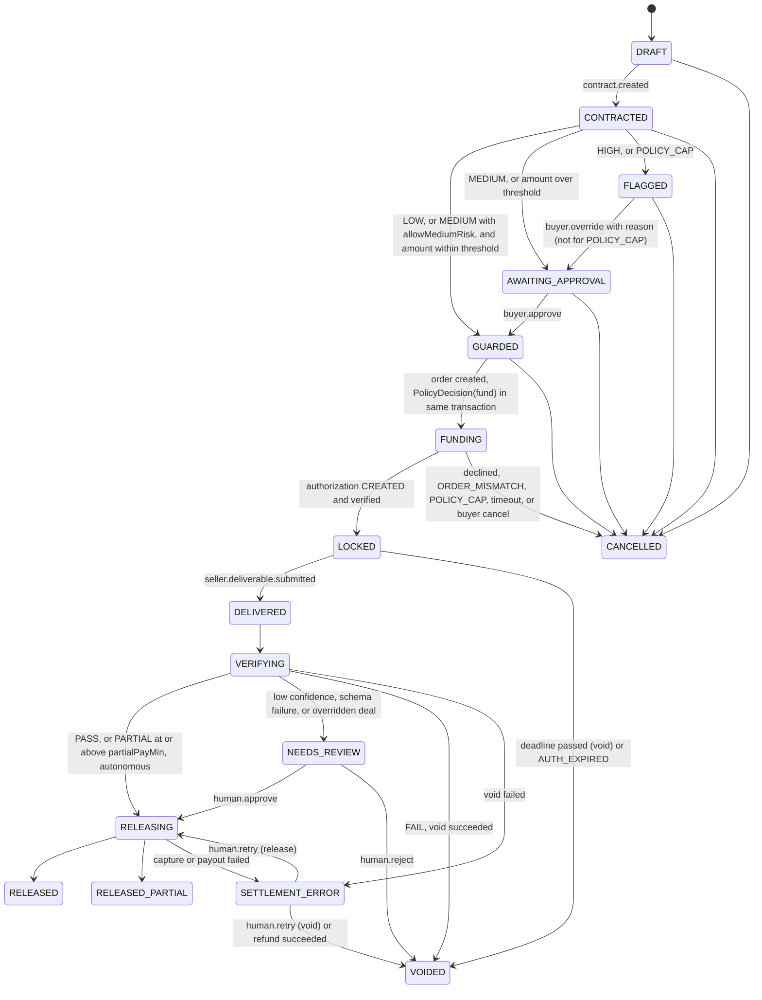

# Paylock: Build Plan

Status: approved 2026-11-05. This is the merged Phase 0 plan, including every amendment agreed in review. When this file and another doc disagree, fix the other doc or raise it; do not silently diverge.

## 1. Goal

Build Paylock in 7 days, from an empty repo to a hosted demo. Paylock reserves buyer funds with a PayPal authorization, gates funding on Trust Guardian risk signals, checks deliverables with the Verifier, and settles deterministically. A pass captures with `final_capture=true` and pays the seller through Payouts. A fail voids the authorization. Every agent decision and payment event appears on an audit timeline.

## 2. Decisions

### 2.1 Phase 0 answers

| Topic | Decision |
|---|---|
| Toolkit location | The PayPal AI Toolkit lives at `../AI-Toolkit` (the owner moves it). It is referenced, never copied. `AI-Toolkit/` is gitignored as a guard. Any reused snippet keeps the Apache-2.0 notice. |
| Money state confirmation | The synchronous PayPal response moves state. Webhooks reconcile and feed the audit trail. Payouts are confirmed by webhook or by polling the batch. `POST /deals/:id/authorize` is called from the v6 `onApprove`. |
| Hosted Verifier | `fetch_url` does plain HTTP, meta-viewport checks and LLM judgment. `run_checks` runs only locally in Docker. On the hosted app those criteria go to LLM judgment or NEEDS_REVIEW. |
| Doc fixes | All 14 reconciliation fixes approved; committed as `docs: reconcile spec with PayPal AI Toolkit references`. |
| Partial release | One capture with `final_capture=true`, no void. Confirm in sandbox (C6) that the remainder is released. |
| Currency | USD only for the demo. Money is a Decimal string everywhere (`^\d{1,10}\.\d{2}$`). |
| Auth | Signed-cookie demo sessions plus scoped API keys. No NextAuth. |
| Webhook signature failure | Return 400, log it, never process or store. |
| Agent-to-agent | P1. MCP stays read-only; the Buyer Agent never calls `pay_order`. Buyer approval happens through v6 in a browser, or the path is scripted. |
| Personas | 4 seeded: Honest Seller, Fresh Account Scammer, Off-Platform Pusher, Bad Deliverable. |
| Honor period | ADR-001 records the value from a real sandbox authorization (C5), not from memory. |
| `allowMediumRisk` | When true, MEDIUM funds autonomously like LOW and the signals are still logged. Default false. |

### 2.2 State machine changes

- New `SETTLEMENT_ERROR` state with a manual retry action and a timeline alert.
- CANCELLED is reachable from DRAFT, CONTRACTED and GUARDED (in addition to FLAGGED and AWAITING_APPROVAL).
- An overridden deal routes release to NEEDS_REVIEW.
- A declined authorization in FUNDING goes to CANCELLED and shows the PayPal reason.
- An authorization that expires while LOCKED goes to VOIDED with reason `AUTH_EXPIRED`; the timeline says "reservation expired".

### 2.3 Decisions A to O (with amendments)

| # | Decision |
|---|---|
| A | The adapter's `captureAuthorization`, `createPayout` and `refundCapture` require a `SettlementApproval`. In the app it is checked against a persisted `PolicyDecision` row. Smoke scripts get a `SmokeApproval` that throws unless `PAYPAL_ENV=sandbox` and the caller is a CLI script. **Amendment:** a static test asserts `SmokeApproval` is imported only from `scripts/`. |
| B | Core settlement moves to Day 2 so the Phase 2 curl happy path can capture. Day 4 connects it to the real Verifier and the UI. |
| C | `PAYLOCK_FREEZE=1` blocks create order, authorize, capture, payout and refund. Void stays allowed so `scripts/void-all.ts` works during a freeze. |
| D | Exceeding `maxPerDeal` or `dailyCap` sends the deal to FLAGGED with reason `POLICY_CAP`; override is disabled, the only exit is cancel. **Amendment:** the daily cap counts deals in LOCKED, DELIVERED, VERIFYING, NEEDS_REVIEW, RELEASING, RELEASED, RELEASED_PARTIAL or SETTLEMENT_ERROR (not VOIDED, CANCELLED, or anything earlier). Because FUNDING deals don't count, the cap is re-checked inside the `/authorize` transaction; if exceeded, the new authorization is voided and the deal goes to CANCELLED with reason `POLICY_CAP`. |
| E | Guardian fallback uses rule signals only. If the deal has messages, the level is at least MEDIUM. |
| F | A failed void goes to SETTLEMENT_ERROR and retry resumes the void. **Updated for the real Payouts statuses:** payout retry re-sends only if the previous item ended `FAILED`, `RETURNED`, `BLOCKED`, `REFUNDED` or `REVERSED`, or the batch ended `DENIED` (there is no item-level `DENIED`). `PENDING`, `UNCLAIMED` or `ONHOLD` mean poll again, never re-send. Each re-send uses a new `sender_batch_id` (`paylock-{dealId}-{attempt}`, since PayPal rejects one reused within 30 days) and keeps `sender_item_id = dealId` so re-sends stay traceable. |
| G | Payout amount equals the captured gross; the platform absorbs PayPal's fee, recorded from `seller_receivable_breakdown`. **Amendment:** `smoke payout` checks the platform balance (`GET /v1/reporting/balances`) before sending. A 403 stops the script with instructions to enable Transaction Search; it is never skipped or stubbed. Add `refundCapture` (P2, `POST /v2/payments/captures/{id}/refund`, gated by `SettlementApproval` and a `PolicyDecision`). Add a runbook step for payout-failed-after-capture. |
| H | Orchestrator code calls read-only skills and fences results into prompts; no open-ended LLM tool loop. **Amendment:** after the eval passes, add an optional bounded read-only tool loop for the Verifier (max 4 calls, `VERIFIER_TOOL_LOOP=1`, off by default), recorded via replay. The eval must still pass with it on. The README must not overclaim autonomy. |
| I | Demo deliverables are hosted by the web app at `/demo/deliverables/[slug]`. `FETCH_URL_DEV_ALLOW_HOSTS` allows localhost only outside production. |
| J | The web app proxies the API through Next.js rewrites (`/api/*`). **Amendment:** `compress: false` in `next.config`; SSE responses send `Cache-Control: no-cache, no-transform` and `X-Accel-Buffering: no`; a test verifies events arrive through the proxy within 2s. 2s polling is the fallback. |
| K | The browser gets `clientId` at runtime from `GET /config/paypal`. No PayPal env var is in the frontend bundle. |
| L | `npm run demo:reset` deletes demo deals and re-bases persona timestamps (scammer account always about 2 days old). |
| M | Seeded buyer policy: maxPerDeal 1000.00, dailyCap 3000.00, approvalThreshold 500.00. |
| N | Orders carry `custom_id=dealId` and no `invoice_id`. |
| O | WORKFLOW scam score becomes 82 (ZERO_HISTORY adds 10). `get_paypal_verification` reads the payer's status from `payment_source.paypal.account_status` after approval, and the seller's from `TrustProfile` at guard time. |

### 2.4 Additions from review

- `/authorize` ignores any client-supplied orderId and uses the stored `paypalOrderId`. Before authorizing it calls `GET order` and checks status `APPROVED`, `amount.value`, `currency_code` and `custom_id`. After authorizing it checks the authorization amount. A mismatch voids any authorization created and sends the deal to CANCELLED with reason `ORDER_MISMATCH`, plus a timeline alert.
- Webhooks only append events and wake the reconciler. The reconciler reads PayPal with `GET` and applies forward-only transitions. Webhooks never regress state.
- E2E funding (Q1=c, conditional on C13): a test-only server-side sandbox card route by default and in CI, plus `npm run e2e:popup` for the real buyer popup, and one manual popup run per phase. The route is registered only when `PAYPAL_ENV=sandbox`, `E2E_FUNDING=card` and `NODE_ENV!=production`; a test asserts it returns 404 with production config. Render never sets `E2E_FUNDING`. If C13 fails, CI mocks PayPal HTTP and those tests are labelled "mocked PayPal" in their names and reports.
- Hosting (Q2=a): API on Render Starter (paid); web and Postgres on free tiers. Re-evaluate the web and Postgres tiers before judging.
- Refund state (default, accepted with "go"): SETTLEMENT_ERROR to VOIDED with reason `REFUNDED`; UI says "funds returned (refunded)". Refund requires a `PolicyDecision`.

### 2.5 Time budget and cut list

Hours of focused work, logged in `docs/progress.md`. If a phase reaches its cut trigger (+25%), apply the next items on the cut list and say which in that phase's report.

| Phase | Budget | Cut trigger |
|---|---|---|
| 1 Money moves | 8h | 10h |
| 2 Deal core | 9h | 11.25h |
| 3 Agents | 9h | 11.25h |
| 4 Guardrails and UI | 10h | 12.5h |
| 5 Deploy | 5h | 6.25h |
| 6 Harden | 7h | 8.75h |
| 7 Submission | 4h | 5h |

Cut order (merged with WORKPLAN, default accepted with "go"):

1. F15 dispute export (not in this plan; already cut)
2. E2E popup run
3. MCP enrichment
4. Verifier tool loop
5. `refundCapture` (runbook falls back to manual payout retry)
6. Agent-to-agent
7. `inspect_repo`
8. F12 community reports (keep static trust data)
9. Playwright reduced to the happy path
10. Partial payments (binary pass/fail)

Never cut: authorize/capture/void, Guardian gating, Verifier, timeline, README, video.

## 3. Design summary

### 3.1 State machine

NEEDS_REVIEW and LOCKED can also reach SETTLEMENT_ERROR when their void fails.

### 3.2 Two-transaction settlement (invariant 1)

1. Transaction 1: `SELECT … FOR UPDATE` on the deal. Check state and that a persisted Decision exists. Evaluate policy (freeze, override, authorization not expired). Insert the `PolicyDecision`, a pending `PaymentRecord` with its idempotency key, the transition, a DealEvent and an AuditLog row.
2. Adapter call. The adapter re-checks the `PolicyDecision` in the DB before sending.
3. Transaction 2: record the result and transition.

A sweeper resumes any pending `PaymentRecord` with the same key after a crash.

### 3.3 Invariant enforcement

| # | Enforced in | Proven by |
|---|---|---|
| 1 | `settlement/settlement.ts` transaction 1 + adapter `SettlementApproval` check | Integration tests; static test that only `settlement/` imports `captureAuthorization`, `createPayout`, `refundCapture`; static test that `SmokeApproval` is imported only from `scripts/` |
| 2 | `paypal/http.ts` | MockAgent tests |
| 3 | `webhooks/route.ts` | Re-formatted JSON and duplicate-event tests |
| 4 | `packages/skills` registry | Tests |
| 5 | `llm/structured.ts` | Tests |
| 6 | `agents/fence.ts` | Prompt-injection eval cases |
| 7 | `llm/redaction.ts` wraps every provider | Provider spy test |
| 8 | `policy/engine.ts` | Tests |
| 9 | `lib/money.ts`, Zod money strings | Tests; lint rule against `parseFloat`/`Number()` on money |
| 10 | `paypal/token.ts`; `.env.example` only; gitleaks in CI | `/paypal:doctor security` |
| 11 | Shared UI copy constants | Test that fails if "scammer" appears in `apps/web` |

### 3.4 PayPal endpoints (sandbox base `https://api-m.sandbox.paypal.com`)

| Call | Used by | What we send | Response fields we rely on |
|---|---|---|---|
| `POST /v1/oauth2/token` | `token.ts` | Basic auth `clientId:secret`; form `grant_type=client_credentials` | `access_token`, `expires_in` |
| `POST /v2/checkout/orders` | `createOrder` | `PayPal-Request-Id`, `Prefer: return=representation`; `intent: "AUTHORIZE"`, `purchase_units[0]` with `custom_id`, `description`, `amount {currency_code:"USD", value}`; `payment_source.paypal.experience_context {shipping_preference:"NO_SHIPPING", return_url, cancel_url}` | `id`, `status`, link `rel` `approve` or `payer-action` |
| `GET /v2/checkout/orders/{id}` | `/authorize` checks, smoke polling, recovery | none | `status`, `purchase_units[0].amount`, `custom_id`, `payment_source.paypal.account_status`, `payments.authorizations[]` |
| `POST /v2/checkout/orders/{id}/authorize` | `authorizeOrder` | Request-Id, Prefer, `{}` | `authorizations[0]`: `id`, `status`, `status_details.reason`, `amount`, `create_time`, `expiration_time` |
| `GET /v2/payments/authorizations/{id}` | sweeper, release guard | none | `status`, `expiration_time` |
| `POST /v2/payments/authorizations/{id}/capture` | settlement | Request-Id, Prefer; `{amount, final_capture:true}` | `id`, `status`, `status_details.reason`, `seller_receivable_breakdown` |
| `POST /v2/payments/authorizations/{id}/void` | settlement, sweeper, void-all | Request-Id, Prefer | `204`, or `200` with `status: VOIDED` |
| `POST /v2/payments/captures/{id}/refund` (P2) | settlement refund | Request-Id, Prefer; `{amount}` | `id`, `status` |
| `GET /v1/reporting/balances` | `smoke payout` pre-check | `currency_code=USD` | `balances[].available_balance` |
| `POST /v1/payments/payouts` | settlement | Request-Id; `sender_batch_header.sender_batch_id = paylock-{dealId}-{attempt}`; `items[0]` `recipient_type:"EMAIL"`, `amount {value, currency:"USD"}`, `receiver`, `sender_item_id: dealId` | `batch_header.payout_batch_id`, `batch_status` |
| `GET /v1/payments/payouts/{batch_id}` | payout poller | none | `batch_status`, `items[0].transaction_status`, `payout_item_id`, `errors.name` |
| `POST /v1/notifications/verify-webhook-signature` | webhook route | 5 `PAYPAL-*` headers, `webhook_id`, raw body spliced as `webhook_event` | `verification_status` |
| `GET /v1/notifications/webhooks-event-types`, `POST`/`GET`/`PATCH /v1/notifications/webhooks` | `scripts/webhook-register.ts` | URL, event list | `id` |
| `POST /v1/notifications/webhooks-events/{id}/resend` | replay tests | none | none |
| MCP SSE `tools/list`, `list_disputes`, `list_transactions` | `scripts/mcp-list-tools.ts`; Guardian enrichment (P1) | app's own token | tool names and schemas |

Webhook subscriptions (names checked against event types, C9): `CHECKOUT.ORDER.APPROVED`, `PAYMENT.AUTHORIZATION.CREATED`, `PAYMENT.AUTHORIZATION.VOIDED`, `PAYMENT.CAPTURE.COMPLETED`, `PAYMENT.CAPTURE.PENDING`, `PAYMENT.CAPTURE.DENIED`, `PAYMENT.CAPTURE.REFUNDED`, `PAYMENT.PAYOUTSBATCH.SUCCESS`, `PAYMENT.PAYOUTSBATCH.DENIED`, `PAYMENT.PAYOUTS-ITEM.SUCCEEDED`, `.FAILED`, `.UNCLAIMED`, `.BLOCKED`, `.RETURNED`, `CUSTOMER.DISPUTE.CREATED`.

Not used: `/v1/payments/payment`, NVP/SOAP, `@paypal/checkout-server-sdk`, reauthorize, v5 `sdk/js`.

### 3.5 CONFIRM items (resolved on Day 1)

| # | Item | Resolution |
|---|---|---|
| C1 | MCP transport is SSE at `/sse` | `scripts/mcp-list-tools.ts` with `@modelcontextprotocol/sdk` `SSEClientTransport` |
| C2 | `mcp_get_disputes` | Read tool list, call `list_disputes` once; rename or delete the SKILLS row |
| C3 | `mcp_list_transactions` | Same; 403 means Transaction Search must be enabled |
| C4 | MCP accepts the app's own token | Tested with C1; if not, MCP enrichment is dropped (assistant token never used) |
| C5 | Honor period | `smoke honor` records `create_time` and `expiration_time`; set `AUTH_SAFE_WINDOW_HOURS` |
| C6 | `final_capture=true` releases the remainder | `smoke partial`: capture 70.00 of 100.00, read authorization status, confirm a second capture is rejected |
| C7 | Request-Id replay | `smoke idempotency`: same key returns same capture id; record same-key-different-body behavior |
| C8 | Payout duplicate behavior | Re-send same `sender_batch_id` and Request-Id |
| C9 | Webhook event names | `GET webhooks-event-types` |
| C10 | JS SDK version | Resolved: v6 |
| C11 | Simulating a declined authorization | Try `PayPal-Mock-Response`; else a sandbox card set to Declined |
| C12 | Which approve link `rel` comes back | Observed in smoke runs |
| C13 | Server-side funding with `payment_source.card` + AUTHORIZE | Smoke flow `card-authorize`; decides the e2e funding mode |

## 4. Tasks

Stop after each phase with: what was built, how it was verified, deviations and why, next phase's risks, time spent. One merge request per phase, Conventional Commits. Every PayPal error gets `/paypal:explain-error` first and a `docs/pitfalls.md` entry.

### Phase 1, Day 1: Money moves (8h)

**Task 1: Repo init and doc reconciliation.** `git init`; `.gitignore` (`.env*` except `.env.example`, `node_modules`, `.next`, `AI-Toolkit/`). Read-only research: RulesHub standard-checkout `rules.md` and TypeScript snippets, v6 sample repo, `paypal/paypal-rest-api-specs` (authorization statuses, void response, Payouts `amount.currency`, refund shape, `final_capture`), sandbox Payouts balance notes, Render free-tier docs, MCP quickstart. Apply fixes 1 to 14, decisions A to O and the additions above. Add ADR-009 (sync confirm plus webhook reconcile), ADR-010 (hosted Verifier limits), ADR-011 (two-transaction settlement). Update DESIGN §2 and §3, WORKFLOW, SKILLS, SECURITY_PRIVACY §4 runbook. Create `docs/pitfalls.md`, `docs/mcp-tools.txt` (pending Task 5), `docs/progress.md`.

**Task 2: Monorepo scaffold and API shell.** Root workspaces, `tsconfig.base.json`, ESLint, Prettier, `.nvmrc`, `docker-compose.yml` (postgres:16), `.env.example`. `apps/api/src/{server.ts, app.ts, config/env.ts, lib/{logger,problem,money,db}.ts, health/routes.ts}`, `packages/schemas/src/money.ts`. Vitest; Zod env; Pino with redaction; `x-request-id`; RFC 7807. Tests: env validation, money math (round down to cents), healthz, problem shape.

**Task 3: PayPal token and HTTP core.** `apps/api/src/paypal/{token,http,errors,idempotency}.ts`. Token refresh 60s before expiry with a shared in-flight fetch. 10s timeout; 3 retries on 429, 5xx, network errors and `PREVIOUS_REQUEST_IN_PROGRESS`; 500ms exponential backoff with jitter; honor `Retry-After`; same Request-Id on every retry; no retry on other 4xx. `PayPalError` with `name`, `details`, `debugId`, `status`. Key `sha256(dealId:action:attempt)`. Tests with undici MockAgent.

**Task 4: Adapter and smoke scripts.** Follow the hook first (`checkout.md`, `payouts.md`, RulesHub snippets). `adapter.ts`: `createOrder`, `getOrder`, `authorizeOrder`, `getAuthorization`, `captureAuthorization(approval, …)`, `voidAuthorization`, `createPayout(approval, …)`, `getPayoutBatch`, `getBalances`, `refundCapture(approval, …)` (P2). Zod-parsed responses, raw kept. `SmokeApproval`. Smoke flows: `token`, `capture`, `void`, `partial`, `payout` (balance pre-check; 403 stops), `idempotency`, `honor`, `card-authorize`, `decline`. Record C5 to C8 and C11 to C13 in ADR-001 and pitfalls.

**Task 5: Webhook receiver, registration, MCP tool list.** WebhookEvent model and first migration; `webhooks/{route,processor}.ts` (raw buffer, verify, 400 on failure, `eventId` PK dedup, async processing); `scripts/webhook-register.ts`; `scripts/mcp-list-tools.ts`; ngrok steps. Resolve C1 to C4 and C9. Real capture events verify `SUCCESS`; `resend` dedups. `/paypal:doctor` on `apps/api/src/paypal/`. Phase 1 report.

### Phase 2, Day 2: Deal core (9h)

- **Task 6** Full Prisma schema plus `PolicyDecision`, `Message`, `Report`, `ApiKey`; Deal `authExpiresAt`, `payoutEmail`, `requiresHumanRelease`, `blockReason`; PaymentRecord nullable `paypalId`, unique `idempotencyKey`, `attempt`, `policyDecisionId`, kinds `order|authorize|capture|void|payout|refund`.
- **Task 7** Pure state machine; exhaustive allowed and rejected transition tests; guards.
- **Task 8** Transition executor with `SELECT … FOR UPDATE`; DealEvent and AuditLog atomic; events emitted after commit; concurrency test.
- **Task 9** Policy engine (daily cap per amended D), PolicyDecision service, payment math.
- **Task 10** REST API, demo cookie auth, API keys, SSE, stub agents (`AGENTS_MODE=stub`). `/authorize` per §2.4. Test funding route guarded per §2.4 with a 404-in-production test.
- **Task 11** Settlement, sweeper, webhook reconciliation (append-only, forward-only), SETTLEMENT_ERROR retry, refund path. `scripts/curl-happy.sh` PASS to RELEASED and FAIL to VOIDED against sandbox. Phase 2 report.

### Phase 3, Day 3: Agents (9h)

- **Task 12** LlmClient (OpenAI `json_schema` strict, Anthropic forced tool), redaction middleware, structured retry, replay provider.
- **Task 13** Skills package with SSRF guard, limits, local-only `run_checks`, read/write registry.
- **Task 14** Negotiator and Guardian (rules, LLM rubric, combine, fallback per E, optional MCP enrichment).
- **Task 15** Verifier (auto checks, judge, weighted score, confidence gate).
- **Task 16** Eval suite (10 cases, 10/10 schema-valid, at least 9/10 correct), orchestrator, real agents connected, then optional Verifier tool loop per H. Phase 3 report.

### Phase 4, Day 4: Guardrails and UI (10h)

- **Task 17** Next.js shell, `/api` rewrites with `compress:false`, demo login, persona picker, landing, deal list, CSP.
- **Task 18** Wizard, risk banner, v6 PayPal button (`web-sdk/v6/core` async, `findEligibleMethods`, `<paypal-button>`, `session.start({presentationMode:"auto"}, fundDeal())`, `data.orderId`).
- **Task 19** Deal detail, timeline (SSE plus polling, aria-live), decision panel, SETTLEMENT_ERROR card, policy settings.
- **Task 20** Playwright happy, scam, fail (card mode), `e2e:popup`. Three green runs in a row. Phase 4 report.

### Phase 5, Day 5: Deploy (5h)

- **Task 21** `render.yaml` (API Starter, web free, Postgres free for now), migrate on deploy, `/healthz`, seed from the API shell (free web services have no shell), `demo:reset`, webhook PATCH to Render URL. **Postgres for judging:** free Postgres expires 30 days after creation (then a 14-day grace period before deletion), and judging runs after Nov 13 and may take weeks. Plan to upgrade Postgres to a paid plan before submission; also document and test once a re-create and re-seed procedure (new instance, update `DATABASE_URL`, redeploy, seed, re-run the three paths) in INSTRUCTIONS section 8. Record the database creation date and expiry in `docs/progress.md`. All three paths on hosted URL. Phase 5 report.

### Phase 6, Day 6: Harden (7h)

- **Task 22** Replay and idempotency tests, timeouts, error and empty states, freeze tests, `void-all.ts`, accessibility pass, `/paypal:doctor` and `/paypal:doctor security`.
- **Task 23** `.gitlab-ci.yml` (lint, typecheck, unit with Postgres, eval with masked secret, build, SAST, Dependency Scanning, gitleaks), fresh-clone test in `node:20`, README toolkit commands actually used. Phase 6 report.

### Phase 7, Day 7: Submission (4h)

- **Task 24** Final README (no autonomy overclaim), LICENSE visible, docs in sync with code, recording checklist, Devpost text, re-check Render tiers.

## 5. Owner prerequisites (before Task 4)

- Sandbox app client id and secret typed into `.env` by the owner, never pasted in chat.
- Payouts enabled on the sandbox app; Transaction Search enabled (needed for the balance check).
- Sandbox buyer and seller personal account emails.
- LLM key and model name.
- ngrok account.
- GitLab remote URL (by end of Phase 1).
